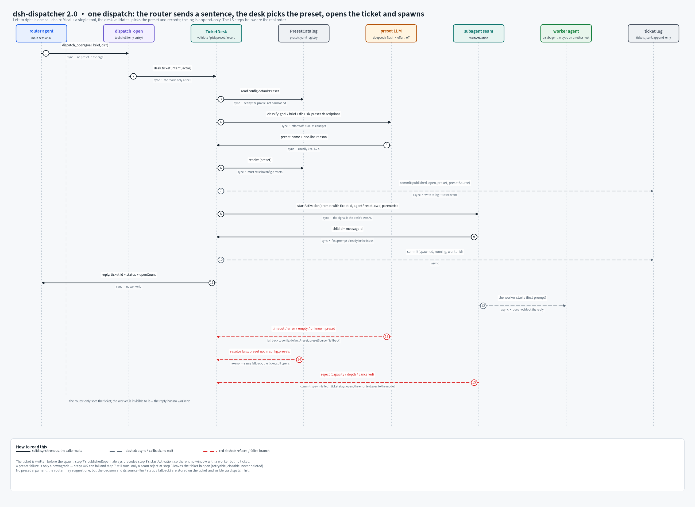
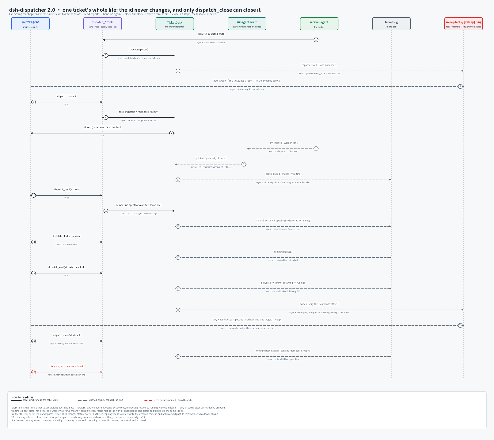

# dsh-dispatcher

[中文](README.md) · English

A dispatch plugin for DeepSeek Harness: the main session stays in the conversation, and worker subagents do the work.

## The idea

The scarcest thing the main session has is a fast reply. The moment it buries itself in a task, whoever is waiting on the other end just waits. This plugin moves long work out of the session and onto a **ticket**: the main session says "open a ticket", the plugin picks a preset, starts a **fish** (a subagent session), records the ticket in the log, and hands control straight back — the conversation continues while the work happens in another session.

The ticket is the single source of truth: who is working, how far along, whether anything was delivered. You read it instead of scrolling back through chat. A fish can only append reports to a ticket; it cannot change status. Status is written by the main session, or by host events when the fish's session ends. So "someone is still waiting" is never decided by a session that no longer exists.



The figure is one call chain: the main session calls `dispatch_open` once, the desk picks a preset, validates, opens the ticket and spawns the fish, then hands back the ticket id and status — the reply carries no workerId, so the main session reads the ticket, not the fish.

## Using it

### Install

```sh
pnpm pack
dsh plugin --profile <name> add ./dsh-dispatcher-2.0.0.tgz
dsh --profile <name> --dump-config | grep 'dsh-dispatcher'
```

Restart the instance; the plugin loads at startup. Tickets default to `$DSH_HOME/dispatcher/tickets.jsonl`: one event per line, append-only.
To use SQLite, set `store.backend: sqlite` (optionally `store.file`; without it the log path just swaps `.jsonl` for `.db`). Both the CLI and the in-process runtime follow that key; see [docs/switch-to-sqlite.md](docs/switch-to-sqlite.md) for switching, verification, rollback and the self-check baselines.

### Minimal config

```yaml
- id: dsh-dispatcher
  name: dsh-dispatcher
  config:
    defaultPreset: t1            # required; must exist in the preset registry
    maxOpen: 4
    allowedPresets: [t0, t1, t2] # mirror used by the preset guard; [] disables the check
```

The full key list, defaults, and the event model live in [docs/internals.en.md](docs/internals.en.md).

### Tools

| Tool | Who calls it | What it does |
|---|---|---|
| `dispatch_open` | main session | Open a ticket in one step: pick a preset, start a fish, write the ticket; returns its id and the open count |
| `dispatch_send` | main session | Append a message for the fish; delivered now if it is idle, queued otherwise |
| `dispatch_read` | main session | Read reports the fish left behind and mark them read; omit `id` for every ticket with unread reports |
| `dispatch_list` | main session | List tickets: `!` gone quiet, `»n` messages not yet received, `«n` reports not yet read |
| `dispatch_block` | main session | Park a ticket while a person decides something |
| `dispatch_close` | main session | Finish it: `done` when the work landed, `dropped` when abandoned; queued messages are voided and the fish is stopped |
| `dispatch_report` | fish | Hand back a report; append-only, it cannot change status |
| `progress_note` | manual | Push one line of progress to the phone without waking a session or touching disk |

### Filling in `goal` and `brief`

Write `goal` in full, in the requester's own words. The fish cannot see the main session's context or what the person just said. Put the ticket id in there (it needs it for `dispatch_report`), along with any progress-reporting or delivery requirement.

`brief` is the one line the little screen shows under the ticket title. It is **required**, capped at 34 character columns by default (a 汉字 counts as 2, so about 17 of them), truncated with `…` when too long, and rejected if empty, whitespace-only, or punctuation-only. Write something like "qqbot PR status" — not a full sentence.

### Ticket status



Six statuses: `open`, `running`, `waiting`, `blocked`, `done`, `dropped`. The first four are open and occupy `maxOpen`. `waiting` only means the fish's session stopped, not that work was delivered — delivery is measured by reports on the ticket.

## Things to watch out for

**Preset choices get rejected.** If the picked preset cannot do the work, no ticket is created: `dispatch_open` fails with an actionable error naming a replacement. Three rules, in order: the preset exists and its toolset loads, it appears in `allowedPresets`, and a task that needs commands gets a preset that actually has a command tool. The classifier also answers whether this round needs commands, with a keyword fallback when it stays quiet (negated clauses such as "do not run commands" are skipped). `rejectOnMismatch: false` turns the whole guard off.

**A fish cannot write memory.** The seven memory-write tools are stripped from its schema (`memory_save`, `memory_archive`, `memory_merge`, and friends); recall stays. It has no `dispatch_block` either — when blocked it says so in a report and waits.

**The sweep only reminds; it never edits tickets.** Once every 10 seconds by default (`sweepMs`): unread reports, finished rounds, and long-running tickets are just a line of state in front of the main session, withdrawn once that ticket has been looked at; only a ticket stuck in `blocked` for 60 minutes actually calls you. It does not collect reports and does not close anything. `maxOpen` defaults to 8, and `done` / `dropped` do not count.

**MCP tools must be named one by one.** The main session keeps only the whitelist, MCP tools are not in it, and there is no wildcard: add each registered name to `extraRouterTools`. A typo costs a warning line, not the whitelist.

**Restart after changing config.** Configuration is read when the plugin loads, and hot reload does not reliably reach sessions that are already running — especially per-session restrictions like whitelists and deny lists. While `~/.dsh/no-restrict` exists, no session gets a whitelist.

**The main session has no shell.** The whitelist takes away file writes and shells; the waiting guard refuses calls that would park it. That is by design, not a permission gap: delegate the work, and spend the main session's words on saying what needs doing.

## Development

```sh
pnpm install
pnpm test       # vitest
pnpm run typecheck
pnpm run build  # tsdown → lib/
```

## License

[Apache License 2.0](LICENSE) © 2026 dsh-dispatcher contributors.
