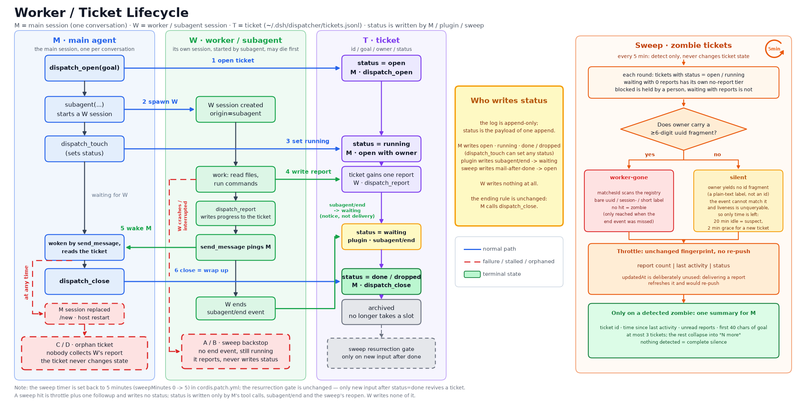
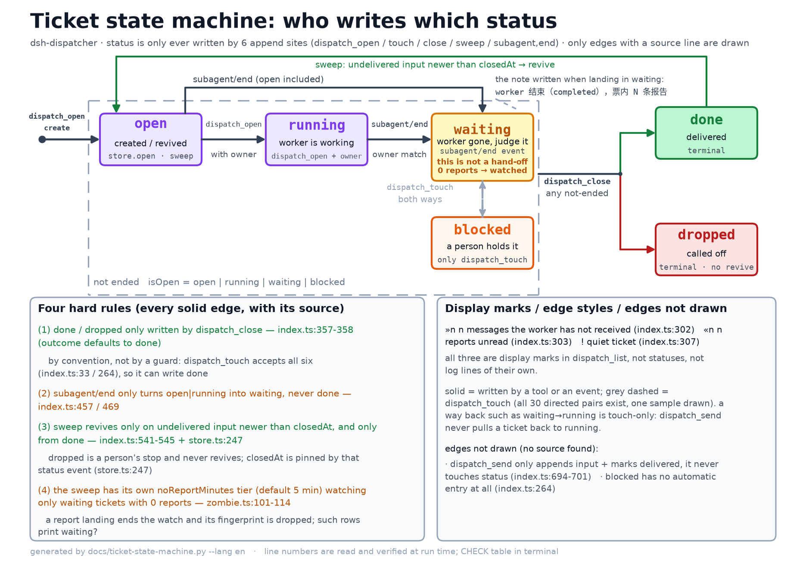

# dsh-dispatcher

[中文](README.md) · English

A dispatch plugin for DeepSeek Harness: the main session keeps talking, worker subagents do the work.

The point is responsiveness. Someone asks a question over QQ and expects an answer now; the main session cannot give one while it is buried in a task. So instead it writes the task down as a ticket, hands it to a worker, and goes straight back to the conversation. The ticket records where the work stands, and it is still there when the main session looks back later.

The design follows the official prototype, [dsh-superagent-prototype](https://github.com/deepseek-ai/dsh-superagent-prototype), and keeps three of its parts:

| Prototype | dsh-dispatcher |
| --- | --- |
| Source / Trigger / Thread / Subscription | Dropped: messages already arrive in the main session |
| Two-layer Eval + versioned Policy | Dropped: the main session decides whether to delegate |
| Dedicated DSH session as Executor | A `subagent`, sharing the working directory |
| Ticket lifecycle + panel + retries | Tickets, status, and a staleness mark |
| Input queue + report delivery | Two queues in the log; a sweep delivers the input queue only, reports are read by the main session |

## Compatibility

| Surface | Status |
|---|---|
| Harness | DeepSeek Harness `0.2.1-rc.5` (peer dep `>=0.1.2-rc.1 <0.3.0`, spelled as several OR'd ranges in `package.json`) |
| Node | `^22.19.0 \|\| >=24.0.0` |
| Platforms | All (plain ESM; no native code, no network) |

## Install

```sh
pnpm pack
dsh plugin --profile <name> add ./dsh-dispatcher-1.2.0.tgz
dsh --profile <name> --dump-config | grep 'dsh-dispatcher'
```

Restart the instance afterwards; the plugin only loads on startup. Tickets default to `$DSH_HOME/dispatcher/tickets.jsonl`: one event per line, append-only, and a half-written trailing line is skipped on read.

## Configuration

| Key | Type | Default | Meaning |
|---|---|---|---|
| `stateFile` | string | `dispatcher/tickets.jsonl` | Ticket log path; a relative path resolves against `DSH_HOME` |
| `staleMinutes` | number | `30` | Silence after which a ticket counts as stale in `dispatch_list` (the `!` mark). It no longer drives any announcement |
| `maxOpen` | number | `4` | Cap on concurrently open tickets; `done` / `dropped` do not take a slot |
| `briefMaxColumns` | number | `34` | Length cap for a ticket's `brief`, in character columns: a CJK character counts 2, a half-width one 1. 34 columns is 17 汉字 — the little screen's second line as measured on 2026-11-02 (10px type, 172px usable width, 17 汉字 or 28 ASCII characters) |
| `handoffPolicy` | boolean | `true` | Append the hand-off rules to the main session prompt; subagent sessions are skipped |
| `handoffPolicyText` | string | the shipped block | The hand-off rules themselves; rewrite the whole block to change the wording, an empty string (or whitespace only) means "do not inject" |
| `sweepMinutes` | number | `5` | Sweep interval; `0` turns the timer off and leaves only the manual `dispatch_sweep` |
| `zombieMinutes` | number | `20` | Silence after which an `open` / `running` ticket is reported once as a suspected zombie. A ticket whose `ownerId` (session id) is no longer in the live registry, or whose owner carries a uuid fragment (bare uuid, `session-` prefix, or a short label like `subagent 34b183b9`) that the registry does not have, is `worker-gone` regardless of this value. A plain-text label like `小丙` has no fragment to compare and leaves only this timeout as a backstop |
| `noReportMinutes` | number | `5` | A `waiting` ticket carrying no report at all is announced once after sitting that long (the worker left without handing anything back). A threshold of its own, not `zombieMinutes`: the worker is already gone, so there is nothing left to wait for. A report landing ends the watch |
| `notifyOwner` | boolean | `true` | Wake the owner session about tickets that went quiet |
| `quietSweep` | boolean | `false` | Never wake the main session on a sweep, not even for a zombie ticket; tickets are still reopened, queued messages still reach live workers and closed tickets' reports are still cleared, and the main session reads reports itself |
| `ownerSessionId` | string | empty | Session to wake; empty picks the c2c session from the QQ prefs file |
| `qqPrefsPath` | string | empty | Conversation-key to session-id map. Empty (the default) reads no file at all, so the owner session has to come from `ownerSessionId`; the path belongs to another plugin and is set in the yml |
| `ownerOpenId` | string | empty | Owner openid, used when more than one c2c session exists |
| `noWaitGuard` | boolean | `true` | Refuse main-session calls that would wait; workers are unaffected |
| `maxCommandMs` | number | `30000` | Longest a single command may hold the main session |
| `maxWaitMs` | number | `5000` | Longest a `job_output` wait may hold the main session |
| `routerRestrict` | boolean | `true` | Give every non-worker session the `routerTools` whitelist |
| `routerEscapeFile` | string | `~/.dsh/no-restrict` | While this file exists the whitelist is not installed on any session |
| `routerTools` | string[] | 32 names | Global tool names the main session keeps; the default list is `DEFAULT_ROUTER_TOOLS` in `src/config.ts`, and holds only this package's own tools plus the host's built-ins |
| `extraRouterTools` | string[] | empty | Tool names registered by other plugins that should stay on the main session. Appended after `routerTools`, passed through as written; names nothing registered are dropped with a warning. Empty by default: this repo names no external plugin |
| `workerToolDeny` | boolean | `true` | Take `workerDenyTools` out of every worker subagent's tool schema; independent of `routerRestrict` |
| `workerDenyTools` | string[] | 7 names | Tool names a worker does not see: the seven write-side memory tools, `DEFAULT_WORKER_DENY_TOOLS` in `src/config.ts` |
| `notifyScript` | string | the `notify.sh` on the host | Script `progress_note` runs to push one line to QQ; it owns the openid, the plugin keeps no second copy |
| `notifyTimeoutMs` | number | `5000` | Hard cap on one progress push; on timeout the child is killed and the call returns `sent: false` |

```yaml
- id: dsh-dispatcher
  name: dsh-dispatcher
  config:
    staleMinutes: 20
    maxOpen: 3
```

**Changing the config needs a restart to take effect.** Values in `cordis.patch.yml` are read once, when the plugin loads, and a hot reload does not necessarily carry the new values to sessions that are already running — especially anything installed per session, like the whitelist and the deny list. Restart the instance after editing `dsh` config; do not expect a one-line yml edit to apply instantly. The bug fixed in 1.1.1 was exactly this: after a hot reload the plugin judged the wrong side of "who is allowed to say a tool does not exist".

## Tools

| Tool | Purpose |
|---|---|
| `dispatch_open` | Open a ticket. Call it right after spawning the worker, before replying. `brief` is required: one short line within 34 columns; `owner` is the human label shown on the little screen and `ownerId` is the raw session id `spawn` returned (see "owner and ownerId") |
| `dispatch_touch` | Change status, with an optional one-line note (`status` is required) |
| `dispatch_list` | List tickets; `!` marks one that has gone quiet, `»n` queued messages, `«n` unread reports. Every row carries `brief` |
| `dispatch_send` | Queue one more message for a ticket's worker |
| `dispatch_report` | Record a report on a ticket without ending it |
| `dispatch_close` | Close a ticket once the work is delivered |
| `dispatch_sweep` | Run a sweep now instead of waiting for the timer: reopen tickets, push queued messages to live 小鱼, clear reports left on closed tickets, judge the zombie tickets. It does not deliver reports |
| `progress_note` | Push one line of progress straight to the owner's QQ while the main session itself is on a long job; wakes no session and writes nothing to disk. Workers do not call it — a worker's progress goes into the ticket with `dispatch_report` |

Six statuses: `open`, `running`, `waiting`, `blocked`, `done`, `dropped`. The first four count as open and take a `maxOpen` slot. `waiting` is what the plugin records when it sees `subagent/end` (the worker session ended): it says the session stopped, not that anything was delivered. `done` still comes only from `dispatch_close`.

### The ticket `brief`

Besides the full `goal`, every ticket carries a `brief`: a one-line summary for the little screen's second line, at most `briefMaxColumns` character columns (default 34 = 17 汉字, the second line measured at 10px / 172px on 2026-11-02). Anything longer is cut and closed with `…`.

`brief` is **required** (since 2026-11-03): `dispatch_open` rejects a missing one at the schema gate, and an empty, whitespace-only or punctuation-only one with "brief 必填，写一句 34 列以内的短话". Nothing is derived from `goal` any more — in practice the field was never filled in, every ticket fell back, and the second line was the goal cut off with an ellipsis again, which made the field pointless. Write a phrase, not a sentence: a 汉字 is 2 columns, so about 17 汉字 is the ceiling.

An over-long `brief` is still cut: the budget reserves 2 columns for the `…` and the body stops at 32, so the whole line is exactly 34 columns wide and whoever renders it never has to measure it.

Tickets written before the field existed simply have no `brief`: `foldEvents` leaves it unset instead of failing, and readers call `briefOf()` to derive one from `goal`. That means every row `dispatch_list` returns has a `brief` that fits, old tickets included. Required on write, derived on read: two separate paths.

## Queues

A ticket carries two queues, both lines in the same log, so a restart loses nothing: messages waiting for the worker (`dispatch_send`) and reports the worker handed back (`dispatch_report`). Each entry has its own id and a `delivered` mark.

`dispatch_send` delivers at once when the worker session is alive and idle, and otherwise leaves the message queued. `dispatch_report` never wakes anyone; the main session reads reports on its next turn with `dispatch_list`, where a ticket's `«n` counts the reports it has not read. A sweep does not collect reports for the main session: it pushes queued messages to live workers and reopens a `done` ticket that received more mail (status only, nobody is woken) — the prototype's `tickets.wake`. A `dropped` ticket is a person's stop and stays shut. Reports left on a closed ticket have no reader left, so a sweep clears them silently by appending a `delivered` mark; it never pushes one.

## The ticket lifecycle



The figure puts one ticket's whole life on one page: on the left M (the main session) opens the ticket, starts W and goes back to talking; in the middle W (the worker) does the work, reports and pings M; on the right the ticket walks `open → running → waiting → done`, each state naming who is allowed to write it, and the far right column is how a sweep picks zombie tickets out.

A ticket ends on two facts only: W delivered, and M called `dispatch_close`. Whether M's session still exists changes nothing — `/new` replacing the session, a host restart, or M simply forgetting does not turn a ticket into `done` on its own. There is exactly one revive gate: new input arriving after `done`, which the sweep reopens. `dropped` is a person's stop and stays shut.

### Who writes status

The ticket log is append-only: `status` is not a mutable field of a record but the payload of one append, folded into the latest value by `foldEvents`. Only these paths write it, and no worker path exists:

- `dispatch_open` writes `open`, then one `running` when an owner is given
- `dispatch_touch` — the main session's own edit
- `dispatch_close` — writes `done` or `dropped`
- the sweep — only reopens a `done` ticket that got mail after closing, and touches nothing else
- the plugin — on `subagent/end` it turns a ticket still in `open` / `running` into `waiting`

A worker holds only `dispatch_report` and `dispatch_send`, and both merely append queue rows. So "why is this ticket still running" is a question for the main session, the sweep, or the host event — never for the worker: it has neither the right nor the code path.



This one is only about status: six statuses, who writes each transition, which edges the code pins down, and a legend that also carries "waiting is not delivery" plus the sweep's own `noReportMinutes` tier.

### A worker ending means waiting, not delivery

The host emits `subagent/end`: the payload carries the sub-session `id` and a `stopReason` (`completed` / `aborted` / `error` / `max-tokens` / `refusal`), and `agent/disposed` is the agent-recycling event. The dispatcher subscribes to `subagent/end`: when the owner matches that id and the ticket is still `open` / `running`, it appends `waiting` (the `note` carries the `stopReason` plus how many reports the ticket already held, e.g. "worker 结束（completed），票内无报告" or "worker 结束（error），票内 2 条报告"), and **never `done`**.

The split is deliberate: the event says the session stopped, not that the work was finished and handed back. A worker may have finished a round and be waiting for a reply, or died halfway; the event looks the same either way. `done` has exactly one source — `dispatch_close`. `waiting` only puts "someone should look at this" onto `dispatch_list`; do not read it as delivery, it does not even guarantee a report exists.

### Waiting is not delivery

There are two kinds of `waiting`: one where the worker handed work back and one where it walked off mid-task. Exactly one fact tells them apart — whether the ticket holds any report: the event that lands a ticket in `waiting` writes the count into its `note` (with zero reports the note says 「票内无报告」), and the `reports` array `dispatch_list` reads carries the same number. That event is the dotted arrow in the figure.

The sweep watches the report-less kind: once a ticket has sat in `waiting` for `noReportMinutes` (default 5) without a single report arriving, it is announced once, and the line says what to do — `dispatch_send` the worker to ask for a report, or go look at what it actually did. As soon as a report lands the ticket stops being a candidate and its fingerprint is dropped by the sweep, so it never fires twice. That branch reads only "is there a report", never `zombieMinutes`: the worker is already gone, there is nothing left to wait for.

That write still calms the `open` / `running` sweep: once W exits, the ticket no longer sits in `running`, so `silent` / `worker-gone` stop firing and only the "nothing handed back" branch takes over. `worker-gone` is left for tickets whose event never arrived — a plugin restart, a ticket opened before the subscription existed, or an owner with no id fragment in it at all.

### owner and ownerId

A ticket carries two fields: `owner` is the label a person reads ("t4 查qqbot PR"), `ownerId` is the session id a machine compares (the raw id `spawn` returned, a uuid; a `session-` prefix is fine). Give both, or only `owner`.

With `ownerId` the sweep can report `worker-gone` at once: `dispatch_open` checks it against the live registry first and refuses the ticket when it is not there ("ownerId 不在活表，可能是填错了或小鱼已经结束"), writing nothing; when no agents service is reachable it lets the ticket through and logs one line. The sweep compares it exactly through `idVariants` (bare uuid / `session-` form) and calls it dead only after finding nothing, without waiting for `zombieMinutes`. `ownerId` is also what `subagent/end` matches tickets on, and what queued messages are steered to.

Old tickets have no `ownerId` and keep the `owner` rules: as long as `owner` yields a run of at least 6 hex digits (bare uuid, `session-` form, a short label like `subagent 34b183b9`), it is compared against every agent in the live `AgentRegistry`. The comparison is `matchesId`: first normalise the `session-` prefix (`idVariants`), then extract uuid fragments on both sides (`hexFragments`, runs of `[0-9a-f]` at least 6 long) and accept a prefix in either direction. A full id, its `session-` form and `subagent 34b183b9` therefore all match; only a sweep of the whole registry that finds nothing counts as dead, and that lands `worker-gone` without waiting for `zombieMinutes`.

A plain-text label such as `小丙` or "restart the fish" yields no fragment, so a miss there means "cannot compare", not "the session is gone" — those tickets fall back to `silent`: one announcement once the last report is `zombieMinutes` old (default 20). And the fingerprint is announced once, so a real id is still the safer owner.

The event side uses the same `matchesId`: when the id in `subagent/end` does not match `ownerId` (or `owner` on an old ticket), the ticket never turns `waiting`.

The figure is generated by `docs/worker-ticket-lifecycle-i18n.py`: after editing the wording run `python3 docs/worker-ticket-lifecycle-i18n.py en` (or `zh`), and `CHECK=1` runs the text-overflow self-check.

## How the main session should use it

Open the ticket, hand off, reply. That order. The ticket is a note to your future self: half an hour later `dispatch_list` says which jobs are still silent, without scrolling back through the conversation.

When a worker needs a decision, it writes the question into `note`, switches the ticket to `blocked`, and lets the main session answer it, ask the person, or drop the work.

Four things belong in every task you hand off: the ticket id, the progress duty (one `dispatch_report` per chunk — never send a worker after `progress_note`, which pushes straight to the phone and leaves the ticket empty), the two-step hand-back (report into the ticket, then `send_message` to ping the main session), and `owner` as a human label plus `ownerId` as the real id `spawn` returned. Long work without progress leaves the person staring at a silent chat. Anything the person adds halfway through goes into the ticket with `dispatch_send`; do not paraphrase it away.

## The waiting guard

A prompt section is a request, not a guarantee: the main session can still sit in a `bash` call for two minutes while the person waits for an answer. So every session except a worker gets a `tools.guard` when it is created, and the guard refuses three shapes outright — a command that runs `sleep`, a `timeoutMs` over `maxCommandMs`, and a `job_output` wait over `maxWaitMs`. A foreground command with no `timeoutMs` is refused too, and the reason names the two ways out. Sessions that already exist when the plugin loads are covered as well, or a reload would only protect the next one.

This is upstream dsh-superagent's `noWait` guard, which caps the router shell at five seconds and refuses the same shapes. What differs is how a session earns the right to wait: there it is the agent preset, here it is `session.header.origin === 'subagent'`.

## The router whitelist

The waiting guard stops a session from blocking on one call; the whitelist stops it from having the call at all. With `routerRestrict` on — the default — every session that is not a worker gets `tools.restrict({ allow: routerTools + extraRouterTools })` when it appears. The main session keeps the ticket tools, delegation, memory, the ways it talks to the person, the read-only file tools (`read`, `glob`) and the read-only host checks; the writing, shell and waiting tools are gone, so "delegate it" stops competing with "just run it here". Workers keep the whole surface, so heavy work has somewhere to go; only the seven write-side memory tools are trimmed (see the next section).

The default list is 36 names and lives in `DEFAULT_ROUTER_TOOLS` in `src/config.ts`. `grep` is deliberately not one of them: a single `-rn` has no ceiling on output size, and the main session's long-context cost is almost entirely cache read (measured at 98.6%), so one uncapped search means paying for the whole log on every later turn. Searching is a worker's job — it brings back a few lines. Names must match the registered global tool exactly. `tools.restrict` throws on an unknown one, and `ctx.effect` hands a throw from its callback to cordis' error handling rather than back to the caller, so the plugin checks the list against the registry first: it warns with the names nothing answers to and drops just those from the filter. A typo costs a log line, not the whitelist.

Hiding a tool is only half of it. Every tool plugin also registers a `tool:<group>` prompt section saying how to use it, and that section is assembled from the prompt registry rather than from the schema list — so the main session used to read "Use `browser_navigate` …" for a tool the whitelist had already taken away. While the restriction is installed the session also gets a scoped `system-prompt/assemble` listener that drops exactly the tool sections whose tools are all hidden. The judgement is deliberately narrow: only `tool:` sections are candidates (persona, plan policy, the hand-off rules and every other prose section are never touched); a section stays when its group name is itself a visible tool (`tool:bash` while `bash` is whitelisted) or when its prose still names a visible tool (`tool:goal` survives on `create_goal`). Nothing is inferred from a shared prefix: `read` and `read_image` are two tools, so one being visible never decides the other's section — with both whitelisted, `tool:read` stays on `read` alone. Both checks read `assembly.tools`, the schemas the model is about to receive, so whitelisted-but-unregistered names cannot keep a section alive. Subagents have their own prompt scope and never see this listener; with the escape file present there is no restriction, so there is nothing to prune either.

### The worker deny list

Since 2026-11-01 the rule is that only the main session writes memory: a worker may recall, never save, archive, merge, reflect, split, consolidate or sleep the memory store. `dsh-memory` enforces it at execute time (`assertMayWrite`), and `workerToolDeny` adds the layer above it — with it on (the default) every worker subagent gets `tools.restrict({ deny: workerDenyTools })` when it appears, so the seven write-side names never reach its schema and the model cannot spend a turn on a call that would be refused. The list is `DEFAULT_WORKER_DENY_TOOLS` in `src/config.ts`: `memory_save`, `memory_archive`, `memory_merge`, `memory_reflect`, `memory_split`, `memory_consolidate`, `memory_sleep`.

It is a deny list and not the reverse whitelist on purpose. `restrict` checks an allow list against the scope's restrictable names, and the only public enumeration (`tools.schemas()`) projects the global layer alone — a worker also inherits whatever a preset registered on the agent plane, so an allow list built from that projection would hide those too and leave the worker with a handful of tools. Naming the seven cannot over-remove anything, and the failure mode of a bad config is a missing restriction rather than a crippled worker: names nothing registers are dropped with a warning, and a list that would cover every registered tool is refused instead of handed to `restrict`. `memory_recall`, `memory_entity` and the chat/search tools stay.

`workerToolDeny` is separate from `routerRestrict` because the two guard different things — one is what the main session can do, the other is who may rewrite what the house remembers — and turning one off must not silently turn the other off. The escape file still turns both off.

Two ways out. `mkdir -p ~/.dsh && touch ~/.dsh/no-restrict` and the whitelist is not installed on any session; delete the file to turn it back on. `routerRestrict: false` turns it off for good. The escape file is read once per session, so a change needs a restart (for a session that already exists, a plugin reload).

## Sweeps and zombie tickets

Every `sweepMinutes` (default 5; `0` turns the timer off and leaves only the manual `dispatch_sweep`) the plugin looks at its own tickets and does four things in order: reopen a `done` ticket that received more mail (status only, the owner is not woken), push queued messages to workers that are still alive, clear the reports left on closed tickets, and judge the zombie tickets — one `followup` message (`source.kind` is `dsh-dispatcher`, so it is distinguishable from a person talking) only when a zombie is found. Reports are never pushed: an open ticket's reports stay pending and the main session reads them with `dispatch_list`. A busy session is skipped and retried on the next sweep; nothing is lost, because the queue is in the log rather than in memory.

Two pools of candidates. The main one is `open` and `running`; `blocked` is held by a person and skipped, and `done` / `dropped` are over. The second is a `waiting` ticket that carries **no report at all** — the worker left without handing anything back, and nothing looked at such a ticket once it landed in `waiting`. That branch runs on `noReportMinutes` (default 5) and never on `zombieMinutes`. A `waiting` ticket that already holds a report is not a candidate: that is work for the main session to collect, not a lost ticket. The main pool has two judgements:

- `worker-gone`: with an `ownerId` on the ticket, that session id is compared exactly (both the bare uuid and the `session-` form through `idVariants`) and a registry that does not have it is dead — the "owner must yield a hex fragment" gate does not apply. An old ticket without `ownerId` falls back to the old rule: when the owner yields a run of at least 6 hex digits (bare uuid, `session-` prefix, or a short label like `subagent 34b183b9`) it is compared against every agent in the live `AgentRegistry` — the registry keys on `agent.session.id`, the same id the ticket records. The comparison is `matchesId`: normalise the `session-` prefix, then compare uuid-fragment prefixes; a hit means alive, and only a full sweep that finds nothing is dead, no matter how recently the ticket moved. A ticket younger than 2 minutes is spared, because `dispatch_open` writes the owner a few seconds before the subagent actually registers.
- `silent`: an owner with no id fragment (`小丙`, "restart the fish"), an empty registry, or no `agents` service leaves nothing to look up, so only time is left — `zombieMinutes` (default 20) without progress, where progress means the last report rather than a mere `dispatch_touch`.
- `no-report`: `waiting` with `reports.length === 0`, announced once it has sat in `waiting` for `noReportMinutes` (default 5). The live registry is not consulted — `waiting` already means the worker is gone. One report ending up in the log removes it from the pool, and the sweep drops its fingerprint on the way out.

The throttle is an in-memory fingerprint, `${reports.length}|${lastActivity}|${status}`. It deliberately avoids `updatedAt`: a sweep's own writes (steering a queued message to a live worker, clearing a closed ticket) append events and refresh that field, so an `updatedAt` key would announce the same ticket again on the next round. The last report's time and the status only move on a real report or a status change. The `no-report` branch rides the same key: the count moves from 0 to 1 exactly when the ticket stops being a candidate, and the sweep never flips a ticket back to `open` (only a `done` ticket reopens), so the key cannot go stale in a way that re-fires. With no new report and no status change a ticket is announced once; a process restart costs at most one repeat.

A summary is pushed only when something is found. When nothing is found the sweep is completely silent — not a single character. The line carries the ticket id, how long it has been idle, which judgement fired, how many reports are unread, and the first 40 characters of the goal; at most three tickets are listed, and the rest are counted as "另有 N 张". A `no-report` hit is worded to be acted on directly — "ticket X's worker left but the ticket holds no report; `dispatch_send` it for one, or go look at what it did". Report bodies stay out: a sweep does not deliver reports, and folding one in would make this a second copy of it.

A sweep only reports; it keeps no books. A `worker-gone` / `silent` / `no-report` hit means throttle plus one followup — no status, no note; the ticket stays exactly where it was. The only writes a round makes are delivery marks: queued messages handed to a live worker, and reports on closed tickets cleared with `delivered`. A dead W does not close the ticket either; that is the plugin's `subagent/end` write, and it lands on `waiting`, not `done`. With `quietSweep: true` the zombie step pushes nothing and remembers no fingerprints either, so a silent round cannot swallow the first real announcement. One `followup` costs a whole main-session turn with all of its context, so quiet mode still reopens tickets, steers live workers and clears the reports left on closed tickets; an open ticket's reports are left untouched, so an outside script can still read the log and push them — this repository ships none, it is a small script plus a timer (say `~/.dsh/dispatcher-notify.sh` on a `systemd` timer).

This is the prototype's `Passes` heartbeat plus `evaluateDue`, with the input delivery work kept and the evaluation dropped: nothing in a sweep asks a model anything.

## Development

```sh
pnpm install
pnpm test       # vitest
pnpm run typecheck
pnpm run build  # tsdown → lib/
```

Tests touch neither the network nor the DSH runtime: they cover event folding, status rules, log round-trips, both queues, and the waiting guard's refusal rules.

## License

[Apache License 2.0](LICENSE) © 2026 dsh-dispatcher contributors.
