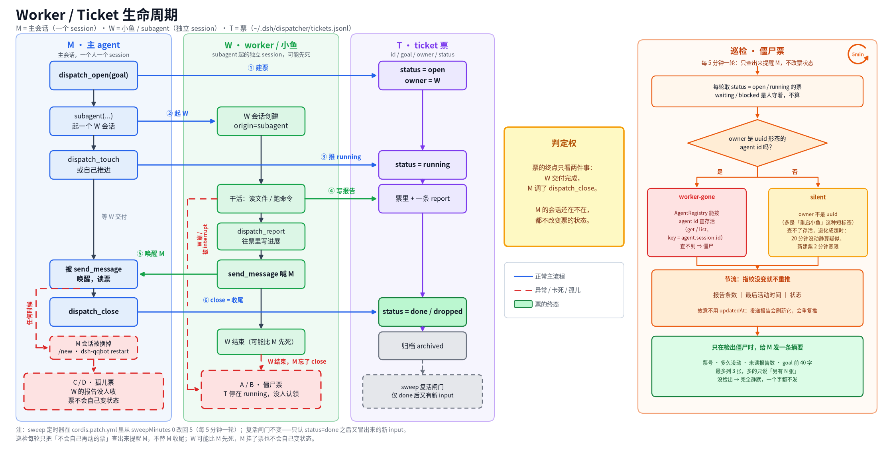
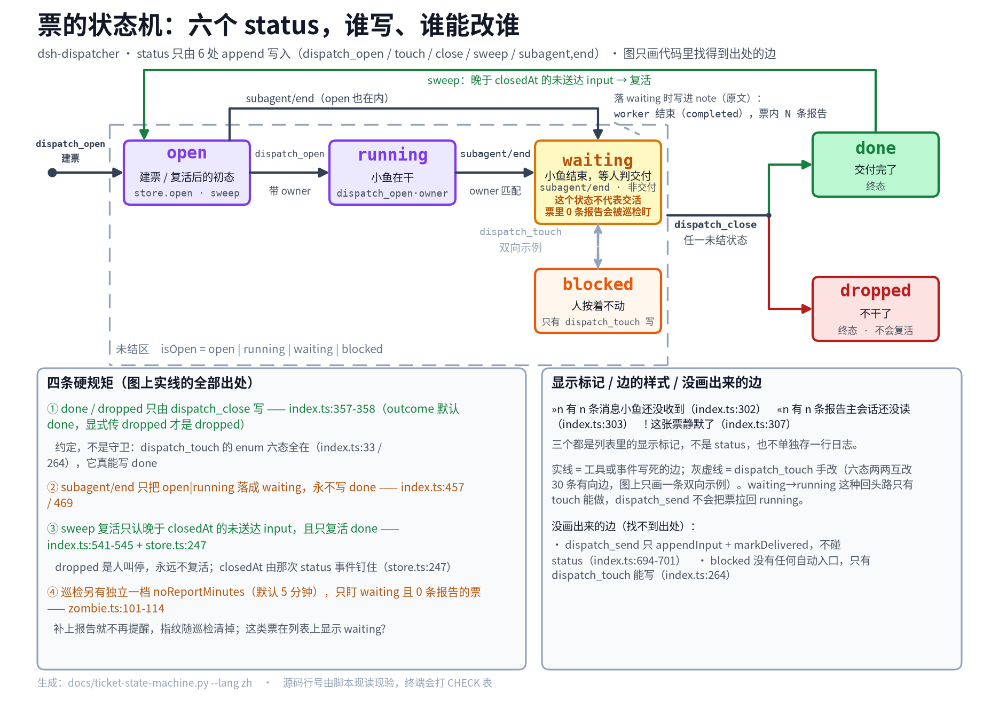

# dsh-dispatcher

[English](README.en.md) · 中文

给 DeepSeek Harness 用的派活插件：主会话负责回话，活交给 worker 子代理去做。

初衷很简单——人在 QQ 里问一句，希望马上有回应。可主会话一旦自己埋头干活，回话就慢了。这个插件让主会话多一件可做的事：把活登记成「票」，派给子代理，然后立刻回来接着聊；票的进展单独记，随时可查。

思路来自官方原型 [dsh-superagent-prototype](https://github.com/deepseek-ai/dsh-superagent-prototype)，但只取了其中三件：

| 原型 | dsh-dispatcher |
| --- | --- |
| Source / Trigger / Thread / Subscription | 不做事件源，消息本来就在主会话里 |
| Eval 双层判定 + 版本化 Policy | 不做，主会话自己判断要不要派活 |
| 独立 DSH 会话当 Executor | 用 subagent，共享工作目录 |
| 票的生命周期 + 面板 + 重试 | 只留票、状态、超时标记 |
| Input queue + report delivery | 两条队列都记在日志里；巡检只送排队消息，报告由主会话自己扫 |

## 兼容性

| 项目 | 状态 |
|---|---|
| Harness | DeepSeek Harness `0.2.1-rc.5`（peer 依赖 `>=0.1.2-rc.1 <0.3.0`，`package.json` 里拆成多条区间用 OR 拼） |
| Node | `^22.19.0 \|\| >=24.0.0` |
| 平台 | 全部（纯 ESM，无原生代码、无网络） |

## 装

```sh
pnpm pack
dsh plugin --profile <name> add ./dsh-dispatcher-1.2.0.tgz
dsh --profile <name> --dump-config | grep 'dsh-dispatcher'
```

装完要重启对应的 dsh 实例才会加载。票默认记在 `$DSH_HOME/dispatcher/tickets.jsonl`，一行一个事件，只追加不改写；读到半截行会跳过。

## 配置

| 键 | 类型 | 默认值 | 说明 |
|---|---|---|---|
| `stateFile` | string | `dispatcher/tickets.jsonl` | 票的日志路径，相对路径按 `DSH_HOME` 解析 |
| `store.backend` | string | `jsonl` | 票日志的后端。`jsonl` 是唯一实现（只追加的文件，格式不变、老数据不用迁移）；`redis` / `sqlite` 只认名字，选了在装载时报「还没实现」，不会悄悄退回文件。后端契约见 `src/store/backend.ts` |
| `staleMinutes` | number | `30` | 列表里 `!` 的阈值：多久没更新算「卡住」。只影响 `dispatch_list` 的标记，不再驱动提醒 |
| `maxOpen` | number | `4` | 同时开着的票上限，`done` / `dropped` 不占名额 |
| `briefMaxColumns` | number | `34` | 票摘要 `brief` 的长度上限，单位是显示列宽：汉字算 2 列、半角算 1 列。34 列 = 17 个汉字，是 2026-11-02 小屏实测的第二行宽度（10px 字号、可用宽 172px，能放 17 汉字或 28 ASCII） |
| `handoffPolicy` | boolean | `true` | 把派活规矩拼进主会话系统提示词；subagent 会话不注入 |
| `handoffPolicyText` | string | 内置那段 | 派活规矩原文；整段重写就能改口径，空字符串（或只有空白）等于不注入 |
| `sweepMs` | number | `10000` | 巡检间隔，毫秒，最小 500；上一拍还堵在队列里就跳过这一拍，不堆空转 |
| `sweepMinutes` | number | 空 | **已过时**，改用 `sweepMs`；显式配了按 `×60000` 折算并 warn 一句，`0` 仍是关定时巡检 |
| `zombieMinutes` | number | `20` | 多久没有任何进展算疑似僵尸票，只推一次。只查 `open` / `running`；票里有 `ownerId`（会话 id）且活表里已经没这个会话，或者 owner 带 uuid 片段（裸 uuid、`session-` 前缀、`subagent 34b183b9` 这类短标签）而扫不到，就判 `worker-gone`，不受这个值约束。`小丙` 这种抽不出片段的纯文字标签只能等这一档兜底 |
| `noReportMinutes` | number | `5` | `waiting` 但票里一条报告都没有的票，落下来多久就推一次（「小鱼退了但没交活」）。单独一项、不吃 `zombieMinutes`：小鱼已经退了，没有值得再等的东西。补上报告之后就不再盯 |
| `notifyOwner` | boolean | `true` | 卡住的票要不要叫醒主人会话 |
| `quietSweep` | boolean | `false` | 巡检时不叫醒主会话，连僵尸票也不推；票照旧重开、排队消息照旧推给活着的 worker、已关票的积压报告照旧清账，报告留给主会话自己看 |
| `ownerSessionId` | string | 空 | 叫醒哪个会话；空则从 QQ 偏好文件里认 c2c 会话 |
| `qqPrefsPath` | string | 空 | 会话映射文件：会话键 → session id。默认空＝不读任何文件，主人会话只能由 `ownerSessionId` 指定；文件路径属于别的插件，由 operator 在 yml 里配 |
| `ownerOpenId` | string | 空 | 主人 openid，多个 c2c 会话时用来挑对的那个 |
| `noWaitGuard` | boolean | `true` | 拦下会让主会话干等的调用；worker 不受影响 |
| `maxCommandMs` | number | `30000` | 单条命令最多占用主会话多久 |
| `maxWaitMs` | number | `5000` | `job_output` 最多占用主会话多久 |
| `routerRestrict` | boolean | `true` | 给每个非 worker 会话装 `routerTools` 白名单 |
| `routerEscapeFile` | string | `~/.dsh/no-restrict` | 这个文件存在时，任何会话都不装白名单 |
| `routerTools` | string[] | 33 个名字 | 主会话保留的全局工具名，默认值见 `src/config.ts` 的 `DEFAULT_ROUTER_TOOLS`：只收本包自己和宿主的内置工具 |
| `extraRouterTools` | string[] | 空 | 别的插件注册、也该留在主会话的工具名。接在 `routerTools` 后面，原样透传；没注册的名字由 router 丢掉并告警。默认空＝本仓库不替任何外部插件点名 |
| `workerToolDeny` | boolean | `true` | 把 `workerDenyTools` 从每个 worker subagent 的工具 schema 里摘掉；跟 `routerRestrict` 各自独立 |
| `workerDenyTools` | string[] | 7 个名字 | worker 看不见的工具名：写记忆那七个，`DEFAULT_WORKER_DENY_TOOLS` |
| `workerPromptPrune` | boolean | `true` | 把 worker subagent 提示词里所有 `tool:*` / `mcp:*` / `mcp-resource-servers` 段整段剪掉；跟 `workerToolDeny` 各自独立，主会话一个字不动 |
| `notifyScript` | string | 安装环境里的 `notify.sh` | `progress_note` 推送用的脚本，openid 在脚本里，插件不存第二份 |
| `notifyTimeoutMs` | number | `5000` | 一次推送最多等多久，超时杀掉子进程并返回 `sent: false` |

```yaml
- id: dsh-dispatcher
  name: dsh-dispatcher
  config:
    staleMinutes: 20
    maxOpen: 3
```

**改完配置要重启才生效。** `cordis.patch.yml` 里的值在插件加载时读一次，热加载不一定把新值送到已经在跑的会话上；白名单和反向名单这类按会话装的东西尤其如此。改完 `dsh` 配置就重启对应实例，别指望改一行 yml 立刻生效——1.1.1 修的那个问题，就是热加载之后判据错在「谁有权说这个工具不存在」。

## 工具

| 工具 | 作用 |
|---|---|
| `dispatch_open` | 开一张票。派完 worker 立刻调，然后才回话。`brief` 必填：一句 34 列以内的短话；`owner` 写人话标签（屏幕上显示的就是它），`ownerId` 填 spawn 返回的原始会话 id（见「owner 与 ownerId」） |
| `dispatch_touch` | 改状态，可附一行进展说明（`status` 必填） |
| `dispatch_list` | 列票，`!` 是卡住的，`»n` 是 worker 还没收到的消息，`«n` 是没读的报告；每行都带 `brief` |
| `dispatch_send` | 往票里追加一条给 worker 的消息 |
| `dispatch_report` | 记一份报告，不结束这张票；不推送，主会话用 `dispatch_reports` 来取 |
| `dispatch_reports` | 读票上的报告正文；默认只给未读，读完标记已读（`dispatch_list` 的 `«n` 跟着归零）。`limit` 默认 10、上限 50，被挡下的不标记；`includeRead` 连已读一起给；省略 `id` 就是所有还有未读的未结票，已关票要按 id 点名 |
| `dispatch_close` | 交付了就关票 |
| `dispatch_sweep` | 立刻跑一次巡检，不等定时器：重开票、给活着的 worker 推消息、清掉已关票的积压报告、看一眼僵尸票。不推报告 |
| `progress_note` | 主会话自己干长活时，把一行进度直接推到主人 QQ 上；不叫醒会话、不写盘。worker 不调它——worker 的进度一律 `dispatch_report` 进票，绕过会话直接推手机，主会话在票里就看不见了 |

状态只有六个：`open`、`running`、`waiting`、`blocked`、`done`、`dropped`。前四个算「还开着」，占 `maxOpen` 名额。`waiting` 是插件收到 `subagent/end`（worker 会话结束）时落的状态，只说明「那个会话停了」，不说明交付；`done` 仍然只有 `dispatch_close` 能写。

### 票的 `brief`

每张票除了完整的 `goal`，还带一句 `brief`：给小屏桌宠第二行用的短摘要，不超过 `briefMaxColumns` 列（默认 34 列 = 17 个汉字，2026-11-02 小屏实测第二行 10px 字号、可用宽 172px），超了截断并补一个「…」。

`brief` 是**必填**的（2026-11-03 起）：`dispatch_open` 不传就被 schema 拦下，传空串、纯空白、纯标点也会直接报错，提示「brief 必填，写一句 34 列以内的短话」。不再从 `goal` 派生——实践下来不填的时候全走回落，第二行又变成被砍出省略号的 `goal`，字段等于白加。写的时候按一句话来，别写长句：汉字算 2 列，大约 17 个汉字就到顶。

超长的 `brief` 照样被截：预算里先扣掉「…」这 2 列，正文切到 32 列，总宽正好 34，显示侧不用自己算宽度。

老票没有这个字段：`foldEvents` 读到没有 `brief` 的事件不会出错（字段留空），读取方用 `briefOf()` 从 `goal` 现算一遍当兜底，所以 `dispatch_list` 里任何一张票都能拿到一句能直接上屏的 `brief`。写入必填、读取回落，是两条路径。

## 只读出口（CLI / service / 快照）

桌宠、`/tickets` 指令和脚本都别再各自解析 `tickets.jsonl`：票的语义只有 dispatcher 这一份，统一从这里出。后端以后换 redis/sqlite，这一层的形状不变。

命令行（`package.json` 的 `bin` 就是它）：

```bash
dsh-dispatcher tickets --json                  # 全部票
dsh-dispatcher tickets --json --open-only      # 只要未结票（--open 是别名）
dsh-dispatcher tickets --json --id t-abc       # 单票，查不到退出码 1
dsh-dispatcher tickets --json --recent 20      # 未结票 + 最近 20 张结票
dsh-dispatcher tickets --state /path/tickets.jsonl
```

`--json` 的形状固定，键序固定，`v` 是 schema 版本：

```json
{"v":1,"generatedAt":"2026-11-04T09:12:33.000Z","counts":{"open":1,"running":2,"waiting":1,"blocked":0,"openTotal":4},"tickets":[...]}
```

| 字段 | 类型 | 说明 |
|---|---|---|
| `id` | string | 票号 |
| `brief` | string | 上屏的一句话（老票从 `goal` 现算） |
| `goal` | string | 完整目标 |
| `status` | string | 六状态之一 |
| `owner` | string \| null | 人话标签 |
| `createdAt` / `updatedAt` / `closedAt` / `statusSince` | ISO 8601 | 建票 / 最后动静 / 关票 / 进入当前状态的时刻；`closedAt` 开着是 null |
| `workerAlive` | boolean \| null | 只是标记：仅 waiting/blocked 有意义 |
| `pendingInputs` / `pendingReports` | number | 没投出去的消息 / 没读的报告 |
| `reportsCount` | number | 全部报告条数（含已读） |
| `ageMinutes` | number | 距 `statusSince` 的分钟数，以 `generatedAt` 为参考 |
| `stale` | boolean | waiting/blocked 超时该催了 |
| `epoch` / `epochReports` | number | 第几轮派活 / 本轮报告数 |
| `preset` / `presetSource` | string \| null | 档位与来源 |
| `dir` / `note` / `device` | string \| null | 工作目录 / 说明 / 机器 |

时间一律 ISO 8601（UTC，带 `Z`），不用 epoch ms。`counts` 按全量日志算，不受过滤影响；屏上的「N 未结」直接取 `counts.openTotal`，不用自己数。

进程内用（`/tickets` 指令、别的插件）：`ctx.get('dispatcher/tickets')` 拿到 `TicketReadout`，`payload(selection)` 给同样的 JSON，`select()` 给带 `goal` 的 `TicketView`，`get(id)` 查单张——不用起子进程。

桌宠读文件：每次票写完，插件会同步原子重写 `$DSH_HOME/dispatcher/tickets.snapshot.json`（`snapshotFile` 可改，空串 = 跟着日志同目录；`snapshotEnabled: false` 关掉）。内容是**全部未结票 + 最近 `snapshotRecentClosed` 张结票**（默认 20），字段和 `--json` 完全一致，`counts` 仍按全量算。写法是临时文件 + `rename`，读方任何时刻都只会读到完整的一份；内容没变（只有 `generatedAt` 会变）就不落盘，稳态不空写。

## 两条队列

一张票带两条队列，都是日志里的行，重启也丢不了：等 worker 收的消息（`dispatch_send`）和 worker 交回来的报告（`dispatch_report`）。每条有自己的 id 和一个 `delivered` 标记。

`dispatch_send` 在 worker 会话活着且空闲时当场送达，否则留在队列。`dispatch_report` 不叫醒任何人，报告正文也不推送：`dispatch_list` 只显示 `«n`（这张票还没读的报告条数），正文由主会话用 `dispatch_reports` 自己取，取走的当场记 `delivered`，`«n` 归零。巡检不替主会话收集报告：它只把排队消息推给还活着的 worker，把「已经 `done` 却又收到新消息」的票重新打开（只改状态、不叫醒人）——这就是原型的 `tickets.wake`；`dropped` 是人叫停的，不再开。已关票上没人会再读的报告由巡检静默清账（补一条 `delivered`），也不推送。

## 票的生命周期



这张图把一条票从 `dispatch_open` 到归档画在一起：左边 M（主会话）开票、起 W、回话，中间 W（worker）干活、写报告、喊 M，右边票按 `open → running → waiting → done` 走，每个状态节点上标着谁能写它，最右一列是巡检怎么把僵尸票挑出来。

票的终点只看两件事：W 交付完成，M 调 `dispatch_close`。M 的会话还在不在都不改变票的状态——`/new` 换掉会话、宿主重启、M 自己忘了关，票都不会自己变成 `done`。复活闸门也只有一个：`done` 之后又冒出新 input，票才会被巡检重开；`dropped` 是人叫停的，不再开。

### 谁写 status

票日志是只追加的：`status` 不是某条记录里的可变字段，而是某一次 append 的 payload，读的时候由 `foldEvents` 折出最后那个值。会写它的只有下面这几路，worker 一路都没有：

- `dispatch_open`：建票写 `open`，带 owner 时紧接着一条 `running`
- `dispatch_touch`：主会话手改
- `dispatch_close`：写 `done` 或 `dropped`
- 巡检：只把 `done` 之后又收到消息的票重开成 `open`，别的票一概不碰
- 插件：收到 `subagent/end` 时，把还挂在 `open` / `running` 的票落成 `waiting`

worker 手上只有 `dispatch_report` 和 `dispatch_send`，两条都只往队列里追加行，碰不到 status。所以一张票「怎么还挂在 running」，要问主会话、问巡检、问宿主事件，别问 worker——它既没有这个权力，也没有这条路径。



这张只画状态：六个 status、每条转移的写入者、哪几条边被代码写死了，图例里也记着 `waiting` 不代表交活、巡检另有一档 `noReportMinutes`。

### worker 结束只落 waiting，不是交付

宿主有 `subagent/end` 事件：payload 带子会话的 `id` 和 `stopReason`（`completed` / `aborted` / `error` / `max-tokens` / `refusal`），另有一个 `agent/disposed` 管 agent 回收。dispatcher 订 `subagent/end`：owner 对得上这个 id、票还挂在 `open` / `running`，就追加一条 `waiting`，`note` 顺手记下 `stopReason` 和票里的报告条数（「worker 结束（completed），票内无报告」「worker 结束（error），票内 2 条报告」这种），**绝不写 `done`**。

分开是有理由的：事件只说明「那个会话停了」，不说明「活干完了、结果交回来了」。小鱼可能跑完一轮正要人接话，也可能崩在半路，在事件里长得一样。`done` 只有一个来源，就是 M 调 `dispatch_close`；`waiting` 只负责把「该有人去看一眼了」摆到 `dispatch_list` 上。别拿 `waiting` 当交付读——它连一份报告都没保证有。

### waiting 不等于交活

`waiting` 有两种：小鱼交完活落下来的，和小鱼一声不吭跑掉的。分这两种只看一件事——票里有没有报告：落 `waiting` 那条 event 会把报告条数写进 `note`（一条报告都没有时 note 就写着「票内无报告」），`dispatch_list` 读到的 `reports` 也是同一个数。图里那条虚线说的就是这条 event。

没报告的 `waiting` 巡检会盯：落 `waiting` 满 `noReportMinutes`（默认 5 分钟）还没补上一条报告，就推一次，文案直接写着「去 `dispatch_send` 叫它补报，或者自己看它干了什么」。补上报告之后它就不再是候选，指纹也随巡检清理消失，不会再响第二遍。这一档只看「有没有报告」，不看 `zombieMinutes`：小鱼已经退了，没有值得再等的东西。

这一笔写下去，巡检对 `open` / `running` 的催命也就轻了：W 一退出，票就不在 `running` 上挂着，`silent` / `worker-gone` 那两档自然停，只剩「没交活」这一档接手。`worker-gone` 从此留给「事件没到」的票——插件重启过、票是订事件之前开的，或者 owner 里根本抽不出 id 片段。

### owner 与 ownerId

票里有两栏：`owner` 是给人看的标签（「t4 查qqbot PR」），`ownerId` 是给机器比的会话 id（spawn 返回的原文，uuid；带 `session-` 前缀也认）。两栏可以一起填，也可以只填 `owner`。

填了 `ownerId` 的好处是巡检能立刻判 `worker-gone`：开票时先拿它查一次活表，不在表里就直接拒绝开票（提示「ownerId 不在活表，可能是填错了或小鱼已经结束」），不写票；查不到 agents 服务时放行并记一条日志。巡检那侧按 `idVariants`（裸 uuid / `session-` 两种写法）精确比对，扫完确实没有就判死，不用等 `zombieMinutes`。`ownerId` 也优先用于 `subagent/end` 对票、以及把排队消息递回 worker。

老票没有 `ownerId`，照旧走 `owner` 那套：能抽出 ≥6 位连续 hex 片段（裸 uuid、`session-`、`subagent 34b183b9` 这种短标签）就拿去活表逐个比对，比对走 `matchesId`——先按 `session-` 前缀归一，再把两边的 uuid 片段抽出来（`hexFragments`，连续 `[0-9a-f]`、至少 6 位），一方是另一方的前缀就算同一路。抽不出片段的纯文字标签（`小丙`、`重启小鱼`）没法和活表比，扫不到只说明「没法比」，不是「会话没了」——这种票退回 `silent`：最后一条报告距今满 `zombieMinutes`（默认 20 分钟）才提醒一次。而同一指纹只推一次，所以老写法下 owner 还是尽量写真 id。

事件这边走同一份 `matchesId`：`subagent/end` 带的 id 对不上 `ownerId`（老票对 `owner`），票也不会落 `waiting`。

图由 `docs/worker-ticket-lifecycle-i18n.py` 生成，改完文案跑 `python3 docs/worker-ticket-lifecycle-i18n.py zh`（英文跑 `en`）重画；`CHECK=1` 会跑一遍文字越框自检。

## 给主会话的用法

一句话：**先开票，再派活，马上回话。** 票是写给半小时后的自己看的——回头 `dispatch_list` 一眼就知道哪些还没消息，不必翻聊天记录。

worker 需要人拍板时，让它把问题写进 `note`、状态改 `blocked`，由主会话决定自己答、来问人，还是拒掉。

派的时候把这几件事写进任务里：票号、打点义务（每出一段进度就 `dispatch_report` 进票——别让小鱼调 `progress_note`，那会绕过会话直接推手机，票里反而什么都没有）、交活两条（先 `dispatch_report` 记结论，再 `send_message` 喊一声）。不打点的长活就是让主人干等。`owner` 写人话标签，`ownerId` 填 spawn 返回的真 id——两栏都填，巡检才不用猜。主人中途追加的话用 `dispatch_send` 进票，别转述丢了。

## 别在中枢等

提示词里写的是请求，不是保证：主会话还是能卡在一个 `bash` 里两分钟，主人在那头等着回话。所以每个会话创建时都会挂一道 `tools.guard`，worker 除外，它拦三种形状——跑 `sleep` 的命令、`timeoutMs` 超过 `maxCommandMs` 的命令、`job_output` 等超过 `maxWaitMs` 的等待；没给 `timeoutMs` 的前台命令也拦，拒绝理由里直接写两条出路。插件加载时已经存在的会话同样补挂，不然热重载只保护下一个会话。

这套是原型 `noWait` 守卫的移植——它把 router 的 shell 上限压到五秒，拦的也是这三样。不一样的是「谁有资格等」怎么判：那边靠 agent preset，这边靠 `session.header.origin === 'subagent'`。

## 主会话白名单

等待守卫是拦住「一次调用卡太久」，白名单是干脆不给它这个工具。`routerRestrict` 开着（默认）时，每个不是 worker 的会话一出现就挂上 `tools.restrict({ allow: routerTools + extraRouterTools })`：主会话留着票、派活、记忆、跟人说话的那几样，加只读文件工具（`read`、`glob`）和只读的机器检查，写盘、shell 和等待类全没了——「派出去」于是不再跟「在这儿干」抢，长活也卡不住回话。worker 这一头留着全套工具，重活才有地方去，只摘写记忆的那七个（见下一节）。

默认 36 个名字，写在 `src/config.ts` 的 `DEFAULT_ROUTER_TOOLS` 里。`grep` 不在其中：它一次 `-rn` 的输出体积没有上限，而主会话的长上下文成本基本全是 cache read（实测占 98.6%），一句没收住的搜索等于按整段日志持续付钱。要搜内容就派 worker，让它把命中压成几行带回来。名字必须跟注册的全局工具名对得上：`tools.restrict` 遇到不认识的名字会抛错，而 `ctx.effect` 把回调里的异常交给 cordis 的错误处理、不会送回调用方，所以插件先对着注册表核一遍——把没人认的名字 warn 出来，只从白名单里剔掉那几个。写错一个名字的代价是一行日志，不是整份白名单。

光把工具藏起来只做了一半。每个工具插件还会注册一段 `tool:<组名>` 的提示段，教模型怎么用它；这段提示是由提示登记表装配出来的，跟工具 schema 列表不是一条路——所以主会话以前会读到「Use browser_navigate…」，去调一个已经被白名单收走的工具。于是装上白名单的同时，这个会话还挂一个 scoped 的 `system-prompt/assemble` 钩子，只删「它讲的工具一个都看不见了」的段。判据收得很窄：只有 `tool:` 开头的段进候选，persona、plan policy、手递手规程和其它所有说明段一概不碰；组名本身就是可见工具的就留（`tool:bash`，因为 `bash` 在白名单里），或者段文本里还提到可见工具才留（`tool:goal` 靠 `create_goal` 留下来）。前缀同源不算证据：`read` 和 `read_image` 是两个工具，谁可见都不能替对方那段作主——两个都在白名单里时，`tool:read` 靠的只是 `read` 自己。两个判断都看 `assembly.tools`，也就是模型这一轮真要收到的 schema 列表——白名单里有但没注册的名字撑不住一段提示。子代理有自己的提示作用域，根本看不到这个钩子；escape 文件在的时候压根没装白名单，也就没有可删的。

### worker 反向名单

2026-11-01 起的规矩：记忆只能主会话写，worker 只许查，不许 save / archive / merge / reflect / split / consolidate / sleep。`dsh-memory` 在 execute 层硬拦（`assertMayWrite`），`workerToolDeny` 是上面那层——开着（默认）时每个 worker subagent 一出现就挂 `tools.restrict({ deny: workerDenyTools })`，这七个名字根本不进它的 schema，模型连「想调一个会被拒的工具」这一步都没有。名单在 `src/config.ts` 的 `DEFAULT_WORKER_DENY_TOOLS`：`memory_save`、`memory_archive`、`memory_merge`、`memory_reflect`、`memory_split`、`memory_consolidate`、`memory_sleep`。

用 deny 而不是反向白名单（allow = 注册表减这七个）是有原因的：`restrict` 拿 allow 去对 restrictable 名字，而唯一公开的枚举 `tools.schemas()` 只投影全局层——worker 还会继承 preset 注册在 agent 层的工具，那些名字不在投影里，按它算 allow 会一起摘掉，worker 直接残废。点名这七个不会多摘任何东西，配错了的后果也只是「没装上限制」，而不是「worker 没工具」：注册表里没有的名字剔掉并告警，覆盖全部注册表的名单直接拒绝、不交给 `restrict`。`memory_recall`、`memory_entity` 和检索类工具照留。

`workerToolDeny` 跟 `routerRestrict` 分开，是因为两件事：一个是主会话能干什么，一个是谁能改这屋子记住的东西；关一个不该顺手关掉另一个。escape 文件两个一起关。

### worker 提示词剪枝

2026-11-03 起，worker subagent 的提示词也过一道 `system-prompt/assemble` 钩子，跟主会话那个同一套判据，只是口径反着：**所有** `tool:*` / `mcp:*` / `mcp-resource-servers` 段一律剪掉，不看这个 worker 还能不能调那些工具。理由是 worker 的工具面由档位（preset）决定，提示词里静态写死的那份清单一定跟它手上的工具表对不上——同一段话对 t2 是多余、对 t4 是错的，而且工具注册时 `description` 已经说清了怎么用。凡是「只能是错的」的说明，留着就是白烧 token：实测这八段（browser / bilibili / bili_notify / jobs / goal / workflow / mcp-resource-servers / mcp:github）合计 4312 字，约 940 token，每条小鱼会话都要吃一遍。

persona、plan policy、手递手规程这些非工具段一概不碰，判据还是 `src/prompt.ts` 的 `sectionToolFamily`。剪枝是**一次装、装完不动**：结论跟 deny 名单无关，所以不跟着 `tools/change` 重装，只在这个 agent 的 scope 销毁时撤掉（`dsh-dispatcher.worker-prompt` effect）。`workerPromptPrune: false` 一键回退到插件自己装配的原样；它跟 `workerToolDeny` 各管一头——一个管手上有什么工具，一个管提示词里还写不写。

主会话那条路一个字没改：它仍旧只剪「工具全被藏起来」的段，`tool:bash` 该留还留。

两条退路。`mkdir -p ~/.dsh && touch ~/.dsh/no-restrict`，任何会话都不装白名单；删掉文件就恢复。`routerRestrict: false` 是彻底关掉。escape 文件每个会话读一次，所以改它要重启（已经存在的会话则是重载插件）。

## 巡检与僵尸票

每 `sweepMs` 毫秒（默认 10000；设 `0` 关掉定时器）看一遍票，按顺序做四件事：把「结束后又收到消息」的票重开（只改状态，不叫醒主会话）、把排队消息推给还活着的 worker、把已关票上没人会读的报告静默清账、把僵尸票查一遍并在检出时推一条 `followup` 给主人会话（`source.kind` 标 `dsh-dispatcher`，跟真人的话区分开）。报告不推：未结票的报告留在 pending 上，主会话用 `dispatch_list` 自己扫。会话正忙就跳过，下一轮再来，一样不丢——队列在日志里，不在内存里。

僵尸票查两类。主池是 `open` 和 `running`；`blocked` 是人按着没动，跳过；`done` / `dropped` 已经结束，也不算。另一类是 `waiting` 但票里**一条报告都没有**——小鱼退了没交活，票落 `waiting` 之后就没人看了，所以单独盯这一档，阈值是 `noReportMinutes`（默认 5），跟 `zombieMinutes` 互不影响。`waiting` 且已经有报告的票不进池：那是主会话该收的活，不是失联。主池判据两档：

- `worker-gone`：票里有 `ownerId` 时直接拿它精确比对（`idVariants` 的裸 uuid / `session-` 两种写法都试），活表里没有就判死，不再受「owner 抽得出片段」那道门限制。老票没有 `ownerId`，退回老规则：owner 里带 ≥6 位连续 hex 片段时（裸 uuid、`session-` 前缀、`subagent 34b183b9` 这类短标签），拿它去 `AgentRegistry` 活表逐个比对——registry 的 key 就是 `agent.session.id`，跟票里记的是同一个。比对走 `matchesId`：先按 `session-` 前缀归一，再比 uuid 片段前缀，命中了就是还活着；扫完确实没有才判死，票多久没动都救不回来。新票留 2 分钟宽限，避开 `dispatch_open` 写 owner 与 subagent 真正注册之间那几秒。
- `silent`：owner 抽不出 id 片段（`小丙`、`重启小鱼`）、或者活表空着 / 没有 agents 服务时，无从查活，只能按时间兜底，等满 `zombieMinutes`（默认 20）没有任何进展才判疑似；进展看最后一条报告的时间，不只看 `dispatch_touch`。
- `no-report`：`waiting` 且 `reports.length === 0`，落 `waiting` 满 `noReportMinutes`（默认 5）就报。不看活表——票是 `waiting` 就意味着 worker 已经不在。补上一条报告就不再是候选，巡检顺手把它的指纹删掉。

节流用内存里的指纹 `${reports.length}|${lastActivity}|${status}`。故意不用 `updatedAt`：巡检自己也会往日志追加事件（给活着的 worker 推消息、给已关票清账），那也刷新 `updatedAt`，拿它当指纹会让刚推过的票下一轮再推一遍；最后一条报告的时间与状态只有真·新报告或状态变化才会动。`no-report` 这档也吃这套：报告条数从 0 变 1 指纹就变，可它同时也不再是候选；而状态不会被巡检翻回 `open`（重开只认 `done` 票），所以指纹不会糊掉。没有新报告、状态也没变，同一张票只推一次，进程重启最多多推一次。

只在检出僵尸时推一条摘要，没检出就完全静默，一个字都不发。摘要一句：票号、多久没动、哪一档、未读报告几条、goal 前 40 字，最多列三张，多的只说「另有 N 张」。`no-report` 那档换成一句能直接处置的话——「票 X 的小鱼退了但票里一条报告都没有，去 `dispatch_send` 叫它补报，或者自己看它干了什么」。不带报告正文——报告不由巡检送，正文塞进来这条消息就成了第二份报告。

巡检只负责提醒，不记账：命中 `worker-gone` / `silent` / `no-report` 之后只做节流、再发一条 followup，日志里不写 status、不写 note，票该挂什么状态还挂什么状态。一轮巡检写盘的地方只有两处，都是投递账：把送给活 worker 的消息标成 `delivered`、给已关票上没人读的报告补 `delivered`。W 死了票也不会被它关掉——那一步现在是插件在 `subagent/end` 里做的，落 `waiting`，不是 `done`。`quietSweep: true` 时僵尸这一步整段不推、也不记指纹，免得静默轮把第一次真推送吞掉。一次 `followup` 就是主会话带着全部上下文重跑一整轮，太贵，所以静默模式仍然照旧重开票、给活着的 worker 推消息、清掉已关票的积压报告；未结票的报告一条都不动，要发给主人就由外部脚本读日志去发——本仓库不带那个脚本，那是几行脚本加一个定时器（比如 `~/.dsh/dispatcher-notify.sh` 配 systemd timer）。

这一段借的是原型的 `Passes` 心跳加 `evaluateDue`，只留下排队消息的投递，评估整个省掉——巡检一次不向模型问任何问题。

## 开发

```sh
pnpm install
pnpm test       # vitest
pnpm run typecheck
pnpm run build  # tsdown → lib/
```

测试不碰网络，也不碰 DSH 运行时，只测事件折叠、状态判定、日志读写、两条队列，以及守卫拦不拦。

## License

[Apache License 2.0](LICENSE) © 2026 dsh-dispatcher contributors.
