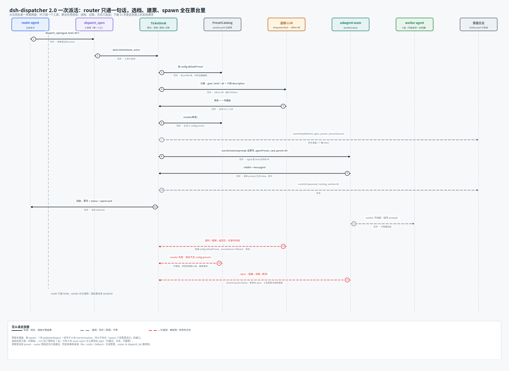
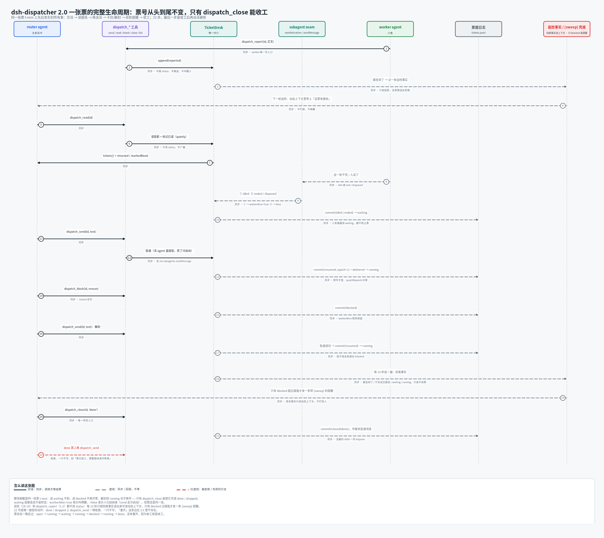

# dsh-dispatcher

[English](README.en.md) · 中文

给 DeepSeek Harness 用的派活插件：主会话负责回话，活交给小鱼去做。

## 基本思想

主会话最贵的资源是「马上回话」。可它一旦自己埋头干活，人在那头就只能等。这个插件把长活从会话里挪出去，落成一张**票**：主会话说一句「开票」，插件挑档、起一只**小鱼**（子代理会话）、把票写进日志，然后把控制权还给主会话——它接着聊，小鱼在另一条会话里干。

票是这中间唯一的事实：谁在干、干到哪、交没交活，全记在票里，不看聊天记录。小鱼只往票里写报告，改不了状态；状态由主会话改，或者由宿主事件（小鱼会话结束）落成 `waiting`。所以「主人在等」这件事，永远轮不到一个已经不在了的会话说了算。



图里是一条调用链：主会话只调一次 `dispatch_open`，票台拿这份意图去选档、校验、建票、起小鱼，最后把票号和状态还给主会话——回执里没有 workerId，主会话看的是票，不是小鱼。

## 怎么用

### 装

```sh
pnpm pack
dsh plugin --profile <name> add ./dsh-dispatcher-2.0.0.tgz
dsh --profile <name> --dump-config | grep 'dsh-dispatcher'
```

装完要重启实例才加载。票默认记在 `$DSH_HOME/dispatcher/tickets.jsonl`，一行一个事件，只追加。

### 最小配置

```yaml
- id: dsh-dispatcher
  name: dsh-dispatcher
  config:
    defaultPreset: t1            # 必填：档位注册表里有的名字
    maxOpen: 4
    allowedPresets: [t0, t1, t2] # 选档校验用的镜像，空数组 = 不校验
```

全部配置项、默认值和事件模型都在 [docs/internals.zh.md](docs/internals.zh.md)，README 里不铺。

### 工具

| 工具 | 谁来调 | 干什么 |
|---|---|---|
| `dispatch_open` | 主会话 | 一步开票：挑档、起小鱼、写票，回执给票号和当前未结数 |
| `dispatch_send` | 主会话 | 往票里追加一条给小鱼的话；它活着且空闲就当场送到，否则排队 |
| `dispatch_read` | 主会话 | 读小鱼交回来的报告，读完标记已读；省略 `id` 读所有还有未读的票 |
| `dispatch_list` | 主会话 | 列票：`!` 卡住、`»n` 小鱼还没收到的消息、`«n` 还没读的报告 |
| `dispatch_block` | 主会话 | 等人拍板时把票挂起，写清在等什么 |
| `dispatch_close` | 主会话 | 收工：`done` 交活、`dropped` 不干了；排队消息作废、小鱼停掉 |
| `dispatch_report` | 小鱼 | 交一份报告，只追加一行，改不了票的状态 |
| `progress_note` | 手工 | 一行进度直接推到手机，不叫醒会话、不写盘 |

### 怎么填 `goal` 和 `brief`

`goal` 原话、完整地写，别缩写：小鱼看不到主会话的上下文，也看不到主人刚说的话。票号要写进去（它得用 `dispatch_report` 交活），打点要求、交活条件也写进去。

`brief` 是给小屏第二行的一句话，**必填**，默认最多 34 列（汉字算 2 列，约 17 个汉字），超了截断补「…」，空串、纯空白、纯标点会被直接拒。写「查 qqbot PR 状态」这种，别写成一句完整的话。

### 票的状态



六个状态：`open`、`running`、`waiting`、`blocked`、`done`、`dropped`。前四个算还开着、占 `maxOpen`；`waiting` 只是小鱼那个会话停了，不代表交活——交没交活看票里有没有报告。

## 注意事项

**选档会被驳回。** 插件挑的档如果干不了这活，就不建票，`dispatch_open` 直接报错并告诉你该换哪档：「任务要执行命令，但 t2（只读）档没有 bash……建议改用 t0」。三条规则按顺序判：档在注册表里且装得上、档在 `allowedPresets` 里、要跑命令的档得真能跑命令。分类器会单独判断这轮要不要执行命令，漏了还有关键词兜底（「不许跑命令」这类否定分句不算）。`rejectOnMismatch: false` 关掉整道门。

**小鱼不能写记忆。** 写记忆的七个工具从它的 schema 里摘掉了（`memory_save`、`memory_archive`、`memory_merge` 等），只许查。它也没有 `dispatch_block`——卡住就在报告里说清卡点，等人回话。

**巡检只提醒，不改票。** 默认 10 秒一轮（`sweepMs`）：未读报告、干完没收工、干完没交报告都只是主会话眼前的一条近况，看过那张票就撤；只有 `blocked` 挂满 60 分钟会真叫你。不替谁收报告，也不把票改成 `done`。`maxOpen` 默认 8，`done` / `dropped` 不占名额，一直挂着的票会一直占着名额。

**MCP 工具要逐条点名。** 主会话默认只保留白名单里的名字，MCP 工具既不在里面也不支持通配：想让它看见，就把每个注册名写进 `extraRouterTools`。写错一个名字只换一行告警，不会带崩白名单。

**改配置要重启。** 插件加载时读一次配置，热加载不保证把新值送到已经在跑的会话；白名单、反向名单这类按会话装的东西尤其如此。`~/.dsh/no-restrict` 这个文件存在时，所有会话都不装白名单。

**主会话手上没有 shell。** 白名单把写盘和 shell 收走了，等待守卫再拦住会干等的调用——这不是权限问题，是设计：要动手就派小鱼，主会话只负责说清楚要干什么。

## 开发

```sh
pnpm install
pnpm test       # vitest
pnpm run typecheck
pnpm run build  # tsdown → lib/
```

## License

[Apache License 2.0](LICENSE) © 2026 dsh-dispatcher contributors.
